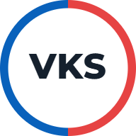
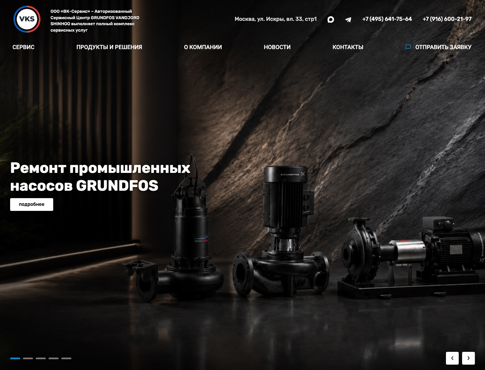
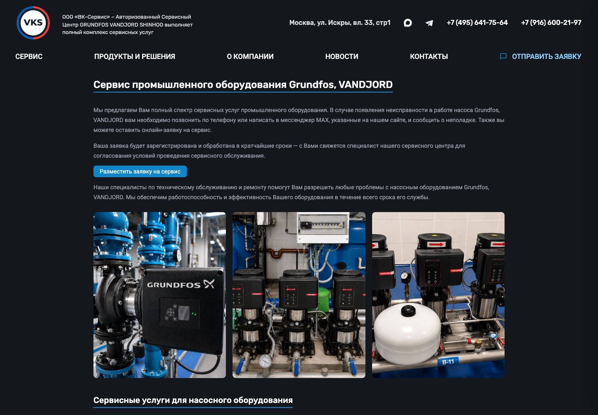
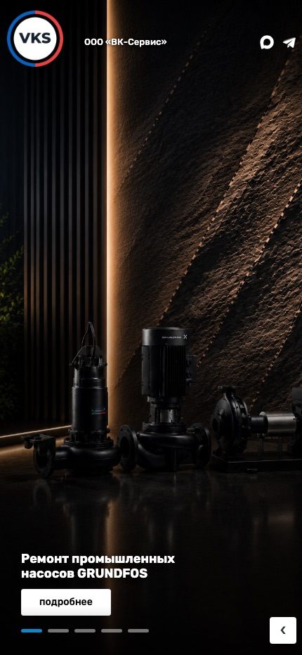

<div align="center">

<a href="https://vknasos.ru/"></a>

# ВК-Сервис

**Корпоративный сайт сервисного центра насосного оборудования**

HTML · CSS · JavaScript · jQuery · Bootstrap · PHP

### [Посмотреть сайт → vknasos.ru](https://vknasos.ru/)

[О проекте](#о-проекте) · [Разработка](#техническая-реализация) · [Скриншоты](#как-выглядит-сайт) · [Запуск](#локальный-запуск)

</div>

## О проекте

Многостраничный сайт компании «ВК-Сервис»: сервис насосного оборудования, подбор запасных частей, ремонт электродвигателей и обслуживание промышленных и бытовых систем.

Сайт объединяет презентацию компании, каталог направлений работы и формы обратной связи. Посетитель может найти нужную услугу, ознакомиться с оборудованием и перейти к заявке. Навигация связывает страницы услуг, информацию о компании, новости, документы и контакты.

## Задачи сайта

- Представить сервисный центр и основные направления обслуживания.
- Организовать услуги по категориям: промышленное и бытовое оборудование, канализационные насосы, электродвигатели, запчасти и автоматика.
- Обеспечить удобный переход от описания услуги к обращению в компанию.
- Сохранить доступность навигации и контента на компьютерах, планшетах и телефонах.
- Объединить заявки и претензии в одном серверном обработчике.

## Интерфейс и страницы

**Главная страница.** Крупный слайдер с направлениями сервиса, заметные переходы к услугам, краткое представление компании и карточки основных разделов. В оформлении используются тёмные фотографии оборудования, синие акценты и контрастная типографика.

**Каталог услуг.** Отдельные страницы для промышленного и бытового сервиса, обслуживания канализационных насосов, перемотки электродвигателей, запчастей и систем управления. Такая структура позволяет подробно раскрыть каждое направление и направить посетителя к подходящей форме.

**Адаптивная навигация.** На широком экране разделы доступны через горизонтальное меню и выпадающие списки. На небольших экранах используется мобильное меню; контактные элементы и блоки страницы перестраиваются под ширину устройства.

**Обращения.** Форма заявки и форма претензии передают разные наборы полей в общий PHP-обработчик. Страница результата оформлена в едином стиле и содержит понятное сообщение и возврат на главную.

## Техническая реализация

| Часть проекта | Реализация |
| --- | --- |
| Страницы | HTML, общие шаблоны шапки, навигации и подвала |
| Вёрстка | CSS, сетка Bootstrap, медиазапросы для разных экранов |
| Интерактивность | JavaScript и jQuery: меню, слайдер, элементы каталога и галереи |
| Формы | Единый обработчик `send-form.php` для заявок и претензий |
| Почта | SMTP-клиент без внешней PHP-библиотеки: STARTTLS и AUTH LOGIN |
| Вложения | Ограничение размера и расширений, сохранение на сервере |
| Конфигурация | Отдельный файл SMTP-настроек и пример конфигурации |

### Серверная логика

Обработчик собирает заполненные поля формы и формирует текст обращения, пропуская технические и пустые поля. Адрес для ответа проверяется перед добавлением в `Reply-To`, а тема письма кодируется в UTF-8. Для SMTP предусмотрены проверка ответов сервера, TLS-соединение и экранирование строк, начинающихся с точки.

В коде предусмотрены honeypot-поле против простых ботов, проверка расширений вложений и лимит 10 МБ на файл. Этапы обработки отмечаются диагностическими кодами: это помогает различать проблемы подключения, TLS, авторизации и передачи письма. Подробные ошибки записываются в серверный журнал.

PHP-обработчик написан с учётом ограничений старого хостинга и синтаксиса PHP 5.3. Клиентская часть организована как статические страницы и набор CSS/JS-файлов, без обязательной сборки фронтенда.

### Организация разработки

Стили, скрипты и графика разделены по каталогам, а страницы сгруппированы по смысловым разделам. Общие визуальные решения — навигация, сетка, кнопки и типографика — используются на разных страницах. Формы используют одну серверную точку входа, что позволяет поддерживать общую логику обработки обращений.

## Структура репозитория

```text
site/
├── index.html                  # Главная страница
├── service/                    # Направления сервиса
├── about/                      # Информация о компании
├── news/                       # Новости
├── contacts/                   # Контактная страница
├── order/                      # Заявка
├── claim/                      # Претензия
├── templates/des/              # CSS, JavaScript и графика
├── modules/                    # Компоненты интерфейса
├── send-form.php               # Обработчик форм
└── smtp-config.php.example     # Пример настроек
docs/images/                   # Логотип и скриншоты
```

## Локальный запуск

Просмотр статических страниц с Python 3:

```sh
python3 -m http.server 8080 --directory site
```

Откройте `http://localhost:8080`.

Для выполнения PHP используйте установленный современный PHP:

```sh
php -S localhost:8080 -t site
```

В репозитории формы работают в демонстрационном режиме: без отправки писем и сохранения вложений. Скриншоты ниже показывают оформление действующего сайта.

## Как выглядит сайт

### Главная страница

[](https://vknasos.ru/)

### Страница промышленного сервиса

[](https://vknasos.ru/service/industrial/)

### Главная на узком экране



---

[Открыть действующий сайт →](https://vknasos.ru/)
